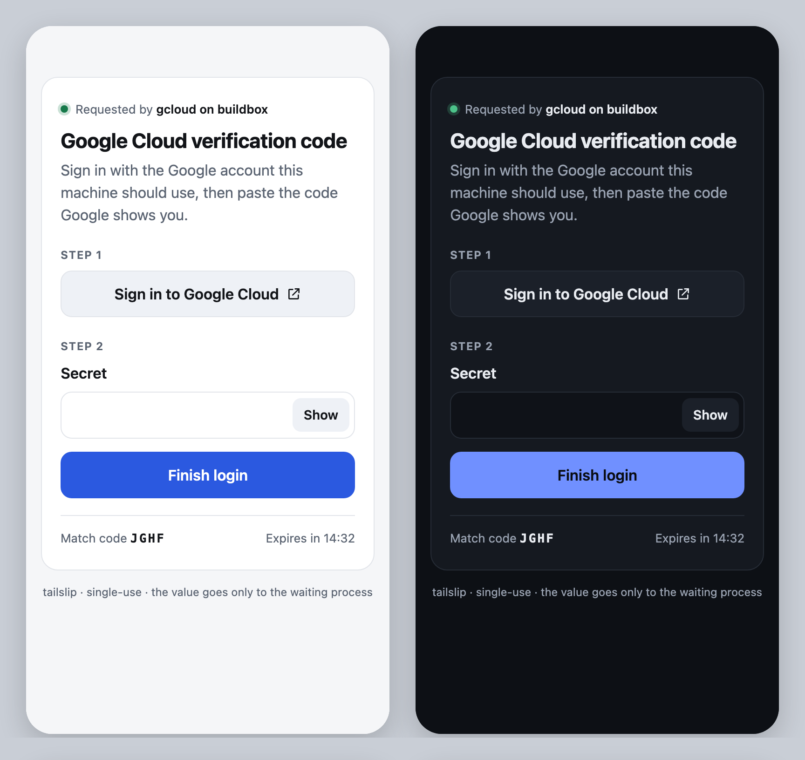

# tailslip

**Hand a value to a process on another machine, from your phone, over your tailnet.**

A script, CI job or AI agent on a headless box needs something only you have: a
one-time code, an OAuth verification code, a token, a passphrase, a key file.
`tailslip` prints a one-time HTTPS link that works only inside your
[Tailscale](https://tailscale.com) tailnet and only for you. You open it on your
phone, paste the value, and it goes straight to the waiting process. The value
never passes through a chat, a clipboard sync, a terminal you have to SSH into,
or the agent's context.

```console
$ code="$(tailslip receive --label "GitHub 2FA code" --pattern '[0-9]{6}')"
tailslip: waiting for "GitHub 2FA code"  (match code K7QM, expires in 15m)
tailslip: only you@example.com can submit
tailslip: open: https://buildbox.tailnet-name.ts.net:49731/8yXc...Qk/
tailslip: GET 200 from you@example.com
tailslip: POST 200 from you@example.com
tailslip: received
```

<p align="center"></p>

- **Python 3.10+ standard library only.** No dependencies; small enough to read in one sitting.
- **Tailscale first.** `tailscale serve` gives the page a real HTTPS certificate, keeps it
  inside your tailnet, and tells tailslip who is asking. By default, only the
  owner of the node can submit.
- **Single-use and short-lived.** One value, then the link returns 410 and
  the serve route is removed. If nobody answers before the timeout (default 15 minutes), tailslip exits with code 3.
- **Built for unattended callers.** stdout carries only the value. Status goes to stderr. Exit codes are meaningful, and `--url-file` writes the link
  where an agent can pick it up and relay it to you.
- **Works with prompts that need a TTY.** `tailslip exec` runs a command on a pty, shows a URL taken from its
  output as a button on the page, and types your value into the prompt.

## Install

```sh
pipx install git+https://github.com/Git-on-my-level/tailslip
# or: pip install git+https://github.com/Git-on-my-level/tailslip
tailslip doctor   # what tailslip detects about this machine
```

## Quickstart

```sh
# Print the value to stdout
token="$(tailslip receive --label "API token for staging" --secret)"

# Write it to a file (atomically, mode 0600)
tailslip receive --label "Vault unseal key" --secret --out ~/.unseal-key

# Multi-line text, or a file upload
tailslip receive --text --label "Paste the PEM" --out key.pem
tailslip receive --file --label "Upload the license file" --out license.lic

# Validate the input (pattern is also enforced in the browser)
tailslip receive --label "6-digit code" --pattern '[0-9]{6}' --timeout 5m

# Add an action button
tailslip receive --label "Device code" --link "https://example.com/activate" --link-text "Open activation page"
```

### Feed a waiting command: `tailslip exec`

```sh
# Type the value into an interactive prompt on a pty that tailslip owns.
# The first URL the command prints becomes the page's button.
tailslip exec \
  --label "Google Cloud verification code" \
  --url-regex 'https://accounts\.google\.com/o/oauth2/auth\S+' --link-text "Sign in to Google Cloud" \
  --wait-for '(?i)verification code' \
  -- gcloud auth login --no-launch-browser

# Write the value to stdin and close it
tailslip exec --stdin --label "Passphrase" --secret -- some-tool --passphrase-stdin

# Put the value in one environment variable of one command
tailslip exec --env GH_TOKEN --secret --label "GitHub token for this box" -- gh auth status
```

In pty mode, terminal echo is off. If the value still shows up in the command's
output, it is replaced with `[redacted]` before tailslip forwards the output. tailslip
returns the command's exit code, or 3 if no value arrived before the timeout.

## How it works

```
 headless box                                             your phone (on the tailnet)
 ┌───────────────────────────────────────────┐            ┌───────────────────────────┐
 │ tailslip ── binds 127.0.0.1:PORT          │            │ https://box.ts.net:PORT/  │
 │   │         random 256-bit path token     │  tailnet   │   <token>/                │
 │   └─ tailscale serve --https=PORT ────────┼───────────►│ [Sign in] [••••••] [Send] │
 │        adds Tailscale-User-Login header   │  WireGuard │                           │
 │                                           │            └───────────────────────────┘
 │ value ─► stdout | 0600 file | pty | stdin │
 └───────────────────────────────────────────┘
```

1. tailslip binds an HTTP server to `127.0.0.1` on a free port, so nothing off the machine can reach it directly.
2. `tailscale serve --bg --https=PORT http://127.0.0.1:PORT` publishes it to your tailnet with a valid
   `*.ts.net` certificate. tailslip never reuses a port that already has a serve handler.
3. You open the link and enter the value. tailslip checks the path token, your tailnet identity,
   that the request comes from the same origin, the per-page CSRF token, the size limit and any pattern, then delivers the value.
4. tailslip removes the serve route and exits.

## Tailnet setup

One-time, in the Tailscale admin console:

1. Enable **MagicDNS** and **HTTPS certificates** (DNS page). `tailscale serve` needs both.
2. Make sure the device you will answer from (your phone, for example) is signed in to the same tailnet as
   the machine running tailslip.

The first request to a new port can take a few seconds while Tailscale provisions the certificate.

Who can submit:

| Flag | Allowed |
| --- | --- |
| *(default)* | the login that owns this node (`tailscale status`) |
| `--allow you@example.com` (repeatable) | exactly these logins |
| `--allow-any-tailnet-user` | anyone signed in to the tailnet |

**Tagged nodes** (servers authenticated with a tag) have no human owner. On those, pass `--allow`
explicitly. Requests that come from a tagged device carry no user identity and are always refused.

## Transports

| `--transport` | Reachable from | Credential | Use when |
| --- | --- | --- | --- |
| `tailscale` | your tailnet, over HTTPS | identity allowlist + URL token | always, if you can |
| `local` | this machine only (`127.0.0.1`) | URL token | same machine, or through an SSH tunnel: `ssh -L PORT:127.0.0.1:PORT host` |
| `lan` | your local network, **plain HTTP** | URL token only | a trusted LAN without Tailscale; see the warning below |
| `auto` *(default)* | `tailscale` if it is running, otherwise `local` | | |

> **`lan` is less safe.** Anyone who sees the URL can submit to it, and anyone on the network path
> can read the value in transit. Use it only on a network you trust and for low-value input.

**`tailscale funnel` is deliberately not supported.** Funnel puts the page on the public
internet, and funnel requests carry no identity header, so the identity check could
not work. Transports are small classes in `src/tailslip/transports.py`, each implementing
`start` / `stop` / `identify`. New ones, such as a Unix-socket serve target or a
different overlay network, fit the same interface.

## Security model

### What tailslip protects against

| Threat | Mitigation |
| --- | --- |
| Someone on the internet finds the page | Bound to `127.0.0.1` and published only with `tailscale serve`, which is reachable only inside your tailnet. No funnel. |
| Another person or device on your tailnet opens the link | The `Tailscale-User-Login` header (injected by `tailscale serve`, which strips any client-supplied copy) must be on the allowlist. Default: the node owner. Missing header → 403. |
| Someone guesses the URL | The path holds a 256-bit random token (`secrets.token_urlsafe(32)`), compared in constant time. A wrong path gets a generic 404. |
| Cross-site request forgery (a malicious page makes your browser submit) | The token in the path is unguessable. The form carries a separate per-page CSRF token, compared in constant time. `Origin` must match the page (`null` is rejected), and `Sec-Fetch-Site` must be `same-origin`/`none`. CSP allows `form-action 'self'` only. |
| Replay, or a second submission | Single-use. The first valid value wins under a lock. Afterwards every request returns 410, and the serve route is removed. |
| A link that stays valid indefinitely | Timeout (default 15 minutes). Then tailslip exits with code 3 and takes the page down. |
| Leaking the value | The value is never logged, never echoed back in a page, never put in a URL, process arguments or the environment (except with `--env`, which you choose). `Value.__repr__` is redacted. Request logs omit the path, which contains the token. In pty mode echo is off and the output is scrubbed. |
| Leaking the URL via Referer | `Referrer-Policy: same-origin`, so cross-origin requests (including the sign-in button) send no Referer. The button also uses `rel="noopener noreferrer"`. `no-referrer` is not used because it makes browsers send `Origin: null` on the form POST, which would disable the Origin check. |
| Caching or framing | `Cache-Control: no-store`, `X-Frame-Options: DENY`, `frame-ancestors 'none'`, `nosniff`, a strict CSP with per-response nonces, and no external assets. |
| Oversized or slow requests | `Content-Length` is required and checked before the body is read (413/411). No chunked bodies. Per-connection socket timeout. A rejected POST closes the connection so an unread body can never be parsed as the next request on a reused proxy connection. |
| Files left readable | `--out` and `--url-file` are written to a temp file created 0600 in the target directory, fsynced, then atomically renamed. An existing symlink is replaced, not followed. |
| Phishing look-alike pages | The page shows a short **match code** that tailslip also prints in the terminal, so you can check that the page belongs to the process that asked. |

### What it does not protect against

- **The machine running tailslip.** Root, and processes running as the same user, can read the
  output file, attach to the receiving process, or talk to `127.0.0.1:PORT` directly and set
  any header. A local process that knows the URL could submit a value of its own before you do. It
  still cannot read the value you submit. tailslip moves a value safely to a
  machine you already trust; it is not a sandbox.
- **A compromised tailnet or admin account**, or a compromised device that is signed in as an allowed user.
- **The receiving program.** What happens to the value after delivery is up to the program that receives it.
- **`lan` transport traffic**, which is plain HTTP (see above).
- **Shoulder-surfing your screen.** Secret fields are masked until you tap *Show*.

## Recipes

| Recipe | What it shows |
| --- | --- |
| [`recipes/gcloud-login/tailslip-gcloud-login`](recipes/gcloud-login/tailslip-gcloud-login) | A human `gcloud auth login --no-launch-browser --update-adc` for a headless box, finished from your phone. It clears `GOOGLE_APPLICATION_CREDENTIALS` and refuses to log a human into a `CLOUDSDK_CONFIG` that holds a service account. The verification code is typed into the same gcloud process that printed the link (codes are bound to that session). |
| [`recipes/otp-to-script/otp-demo.sh`](recipes/otp-to-script/otp-demo.sh) | Pass a 6-digit code to a script three ways: capture it, pipe it to stdin, or set one environment variable. |
| [`recipes/file-drop/file-drop.sh`](recipes/file-drop/file-drop.sh) | Upload a key or license file to a headless box from a browser, stored with mode 0600. |

### Agent pattern

```sh
tailslip receive --label "Deploy approval passphrase" --secret \
  --url-file /tmp/handoff.url --out /tmp/handoff.value &
# The agent reads /tmp/handoff.url and sends the link to the human.
# The human submits on their phone; the agent only learns that the file exists.
wait $! && use-the-value-from /tmp/handoff.value
```

## Reference

```
tailslip receive [options] [--out FILE]
tailslip exec    [options] [--url-regex RE] [--wait-for RE] [--stdin | --env NAME]
                 [--no-newline] [--delay S] -- COMMAND [ARGS...]
tailslip doctor

What to ask for:
  --label TEXT          page title
  --prompt TEXT         instructions under the title
  --link URL            optional action button (http/https only)
  --link-text TEXT      its label
  --kind line|secret|text|file   (or --secret / --text / --file)
  --pattern REGEX       value must fully match
  --max-bytes SIZE      default 4K line/secret, 256K text, 16M file
  --submit-text TEXT    submit button label
  --from TEXT           "Requested by ..." (default: host, or "cmd on host")
  --timeout DURATION    e.g. 90s, 15m, 1h (default 15m)
Transport:
  --transport auto|tailscale|local|lan
  --allow LOGIN         repeatable; default: node owner
  --allow-any-tailnet-user
  --port N              default: a free random port
  --bind ADDR           local/lan only
  --public-host HOST    lan: host in the URL
  --tailscale-bin PATH  or $TAILSLIP_TAILSCALE
Output:
  --url-file FILE       also write the link here (0600)
  -q, --quiet           no request log lines
```

| Exit code | Meaning |
| --- | --- |
| 0 | value delivered (`exec`: the command's own exit code) |
| 1 | error (for example, tailscale is not running or serve failed) |
| 2 | usage error |
| 3 | timed out; nothing was received |
| 130 / 143 | interrupted (SIGINT / SIGTERM). The serve route is still removed. |

## Development

```sh
PYTHONPATH=src:tests python -m unittest discover -s tests -t tests -v
```

The tests cover the guards: wrong path (404), wrong or missing identity (403), single use (410),
CSRF and Origin rejection, size limits (413/411), timeouts, 0600 files, keep-alive safety, and that
no value or token appears in logs. They also run the real CLI end to end, including `exec` in pty, stdin and env modes.
None of them need Tailscale; a fake `tailscale` runner checks the exact `serve` commands.

## Limitations

- In pty mode, values longer than about 1,000 bytes can hit the terminal's line-length limit (`MAX_CANON`). Use `--stdin` for
  long input.
- `exec` pty mode needs a POSIX system (Linux, macOS). `receive` works anywhere Python runs.
- Requires a Tailscale CLI new enough for `tailscale serve --bg --https=PORT` (2023 or later).

## License

MIT
